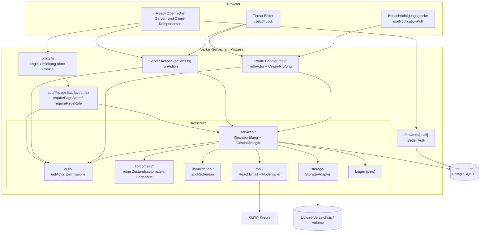
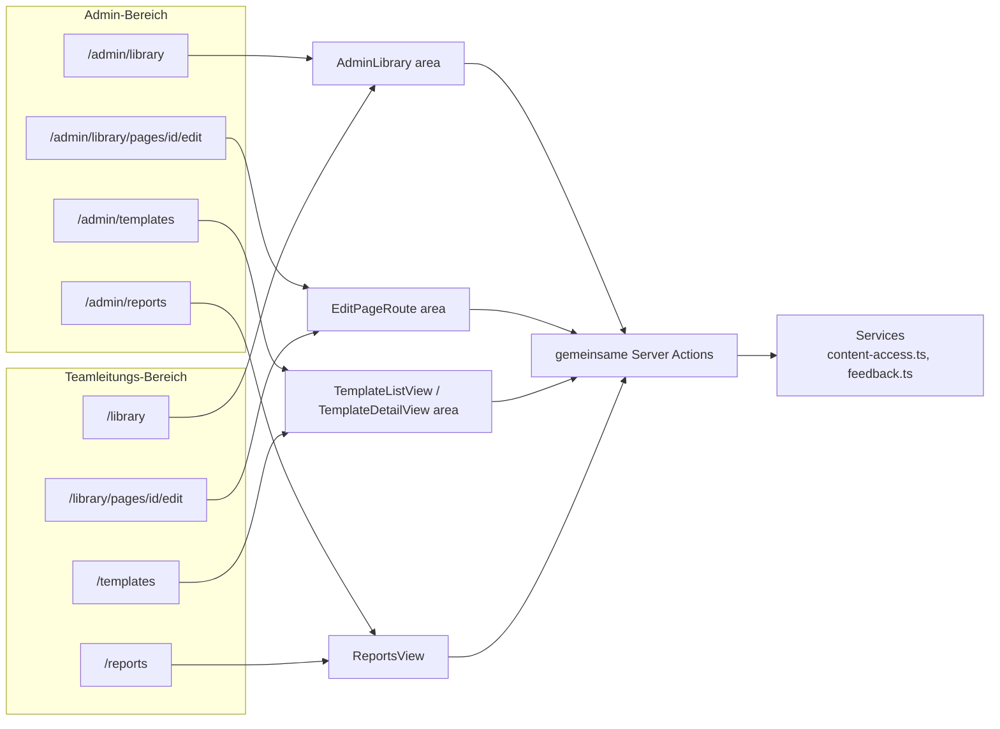
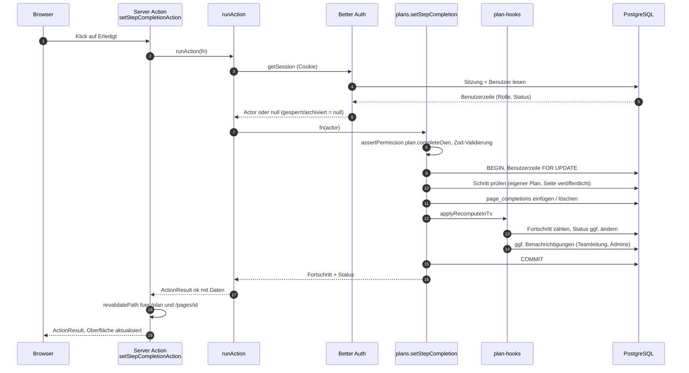
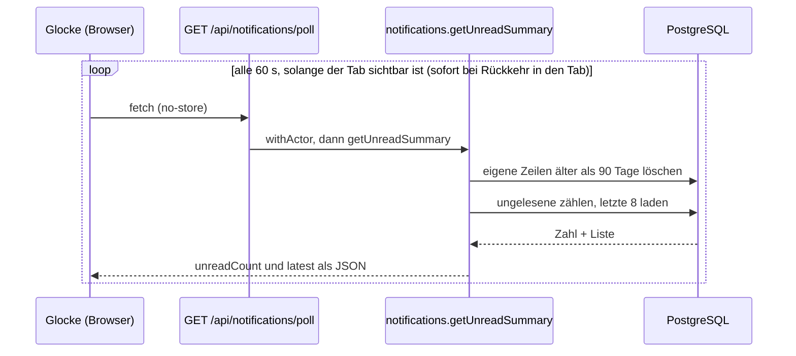
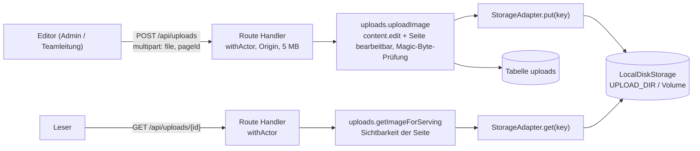
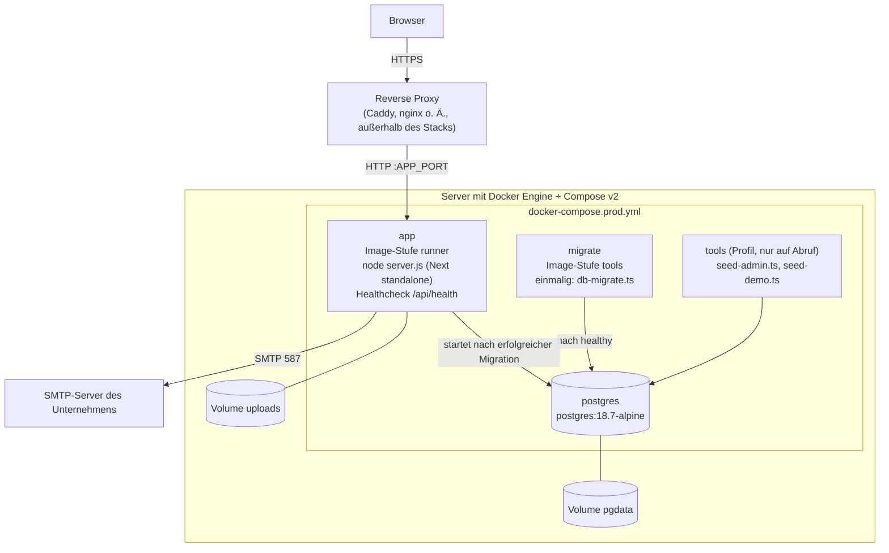

# Systemarchitektur

Überblick über Aufbau, Schichten und Laufzeitverhalten von Startklar (Stand v1.1). Die
ausführliche technische Spezifikation steht in `docs/v1-architecture.md` (Erweiterungen v1.1: Abschnitt 15).
Dieses Dokument beschreibt den umgesetzten Stand.

## 1. Technologie-Überblick

| Bereich            | Technologie                                                                                     |
| ------------------ | ----------------------------------------------------------------------------------------------- |
| Laufzeit           | Node.js 24 LTS                                                                                  |
| Framework          | Next.js 16 (App Router, React Server Components, Server Actions), React 19, TypeScript (strict) |
| Datenbank          | PostgreSQL 18, Zugriff über Drizzle ORM, SQL-Migrationen im Repository                          |
| Authentifizierung  | Better Auth 1.7 (E-Mail + Passwort), Sitzungen in der Datenbank                                 |
| Validierung        | Zod 4: dieselben Schemas für Formulare und Server-Eingaben                                      |
| Oberfläche         | Tailwind CSS 4, shadcn/ui (Radix), Theme hell/dunkel/System über `next-themes`                  |
| Editor             | Tiptap 3, Inhalte als Tiptap-JSON                                                               |
| Mehrsprachigkeit   | next-intl 4, Texte in `messages/{de,en}/<namespace>.json` (20 Namespaces)                       |
| Mail               | Nodemailer (SMTP) + React Email; lokal Mailpit                                                  |
| Suche              | PostgreSQL-Volltextsuche (`german` / `english`)                                                 |
| Logging            | pino (strukturiertes JSON, sensible Felder maskiert)                                            |
| Tests              | Vitest (Unit + Integration mit echter Datenbank), Playwright (E2E)                              |
| Betrieb            | Docker-Image (mehrstufig) + `docker-compose.prod.yml`                                           |

Es ist eine einzige Next.js-Anwendung (kein Monorepo, kein separates Backend). Frontend und Backend
laufen im selben Prozess; die Trennung erfolgt über Schichten und die Regel, dass nur Server-Code
(`import "server-only"`) auf Datenbank, Mail und Dateisystem zugreift.

## 2. Schichtenmodell

| Schicht                    | Verzeichnis                                   | Aufgabe                                                                                                                                                               |
| -------------------------- | --------------------------------------------- | --------------------------------------------------------------------------------------------------------------------------------------------------------------------- |
| Darstellung                | `src/app`, `src/components`                   | Seiten (Server Components laden Daten direkt über Services), interaktive Teile als Client Components. Keine Texte im Code, nur i18n-Schlüssel; Farben nur über Design-Tokens (`src/styles/tokens.css`). |
| Einstiegspunkte            | `src/app/**/actions.ts`, `src/app/api/**`     | Server Actions für Formulare und Mutationen; Route Handler nur, wo `fetch`/Beacon nötig ist (Polling, Sperren, Bilder, Auth, Health).                                 |
| Querschnitt                | `src/server/actions`, `src/server/http`       | `runAction` / `withActor`: Akteur ermitteln, Fehler einheitlich auf `ActionResult` bzw. HTTP-Status abbilden.                                                         |
| Anwendungslogik (Services) | `src/server/services`                         | Einziger Ort mit Datenbankzugriff. Jede Funktion prüft Rechte, validiert die Eingabe mit Zod und arbeitet in Transaktionen.                                           |
| Domäne                     | `src/lib/domain`                              | Reine Funktionen ohne Ein-/Ausgabe: Seitenstatus, Onboarding-Status, Fortschritt, Sprachauswahl. Separat unit-getestet.                                              |
| Datenzugriff               | `src/server/db`                               | Drizzle-Schema, Verbindungspool, Typen.                                                                                                                               |
| Infrastruktur-Adapter      | `src/server/mail`, `src/server/storage`       | Mailversand und Dateiablage hinter Schnittstellen, im Test austauschbar (In-Memory-Mailtransport).                                                                    |
| Konfiguration              | `src/config/app.ts`, `src/config/env.ts`      | Alle Konstanten an einer Stelle; Umgebungsvariablen beim Start mit Zod geprüft.                                                                                       |

Kopplung zwischen fachlichen Bereichen: Inhalte und Organisation importieren die Plan-Services nicht.
Sie rufen definierte Hooks (`plan-hooks.ts`) in ihrer eigenen Transaktion auf, z. B. „Seitenstatus
geändert“ oder „veröffentlichter Inhalt geändert“. Die Hooks berechnen Fortschritte neu und erzeugen
Benachrichtigungen.

### 2.1 Services

| Service                                   | Aufgabe                                                                                                       |
| ----------------------------------------- | ------------------------------------------------------------------------------------------------------------- |
| `org.ts`, `users.ts`, `invitations.ts`    | Abteilungen, Teams, Stellenrollen (seit v1.1 je Abteilung), Benutzer, Einladungen                             |
| `modules.ts`, `pages.ts`, `uploads.ts`, `locks.ts` | Inhaltsbibliothek, Editor-Speichern, Bilder, Bearbeitungssperre                                      |
| `visibility.ts`                           | die einzige Sichtbarkeitsregel für Seiten                                                                     |
| **`content-access.ts`** (neu in v1.1)     | Redaktionsbereich: ermittelt die Abteilung einer Teamleitung in der laufenden Transaktion (`editorDepartmentIdInTx`) und entscheidet über Bearbeitungsrechte an Modulen, Seiten und Vorlagen (`canEditModule`, `canEditPage`, `canViewTemplate`, `canManageTemplate`) einschließlich der Wahl zwischen `FORBIDDEN` und `NOT_FOUND`. Wird von `modules.ts`, `pages.ts`, `uploads.ts`, `locks.ts`, `templates.ts` und `feedback.ts` genutzt, damit die Regel nur an einer Stelle steht. |
| `templates.ts`, `plans.ts`, `plan-hooks.ts` | Vorlagen (seit v1.1 auch von Teamleitungen, `lead_managed`), Zuweisung, Fortschritt, Hooks                  |
| `dashboards.ts`, `search.ts`              | Übersichten, Volltextsuche                                                                                    |
| `notifications-core.ts`, `notifications.ts`, `events.ts` | Benachrichtigungen erzeugen und lesen, Veranstaltungen                                         |
| **`feedback.ts`** (neu in v1.1)           | „Problem melden“: Meldung anlegen (mit Rate Limit über eine Advisory-Sperre je Person), Liste und Zähler je Zuständigkeitsbereich, Status und Antwortnotiz, Löschen (nur Admin), Aufbewahrung 180 Tage. Erzeugt beim Erledigen die Benachrichtigung `feedback_resolved` über `notifications-core.ts`. |
| `profile.ts`, `health.ts`, `bootstrap.ts`, `row-locks.ts` | Profil, Healthcheck, erster Admin, gemeinsame Zeilensperren                                      |

### 2.2 Bereichsparametrisierte Oberfläche (v1.1)

Teamleitungen nutzen für Bibliothek, Editor und Vorlagen dieselben Komponenten wie der Admin. Die
Komponenten erhalten einen Parameter `area` (`"admin"` oder `"lead"`); `src/lib/area-routes.ts` liefert
dazu die passenden Routen. Die Server Actions sind rollenunabhängig; welche Operation erlaubt ist,
entscheiden allein die Services. Die Oberfläche blendet nur die Steuerelemente aus, die laut Service
ohnehin abgelehnt würden (z. B. Bearbeitungsflags je Modul, `canManage` je Vorlage).

Öffnet ein Admin `/library` oder `/templates`, wird er auf seine Admin-Seite umgeleitet. Der Menüpunkt
„Vorlagen“ erscheint nur bei Teamleitungen; der Admin erreicht Vorlagen und Meldungen über „Verwaltung“.

## 3. Ablauf einer Anfrage: Server Action → Service → Datenbank

Beispiel: Eine Person markiert einen Schritt als erledigt.

Fehlerbehandlung: Services werfen `AppError` mit einem Code (`FORBIDDEN`, `NOT_FOUND`, `VALIDATION`,
`CONFLICT`, `LOCK_LOST`, seit v1.1 `RATE_LIMITED` …) und einem i18n-Meldungsschlüssel. `runAction` wandelt sie in
`{ ok: false, error }` um, Zod-Fehler in Feldfehler, bekannte PostgreSQL-Fehler (Unique, Fremdschlüssel)
in fachliche Codes. Route Handler bilden dieselben Codes auf HTTP-Status ab (z. B. 401, 403, 404, 409,
413, 415, 423, 429). Unbekannte Fehler werden geloggt und als `INTERNAL` gemeldet, ohne Details preiszugeben.

Lesende Seiten (Server Components) rufen die Services direkt auf. Bei `NOT_FOUND` wird die 404-Seite
gezeigt.

## 4. Authentifizierung und Sitzungen

- **Better Auth** stellt Anmeldung, Abmeldung und „Passwort vergessen“ unter `/api/auth/*` bereit.
  Selbstregistrierung ist abgeschaltet; ebenso alle Endpunkte, die die Services umgehen würden (404).
- **Konten** legt nur der Admin an (`users.createUser`). Die Person erhält eine Einladungsmail mit
  einem Einmal-Link (72 Stunden). Das Token wird nur als SHA-256-Hash gespeichert. Beim Festlegen des
  Passworts werden alle bestehenden Sitzungen der Person beendet.
- **Sitzungen** liegen in der Tabelle `sessions` (Cookie mit Sitzungstoken, 7 Tage, gleitend um einen
  Tag verlängert). Der Cookie-Cache von Better Auth ist bewusst aus: jede Anfrage liest Benutzer und
  Sitzung aus der Datenbank, damit Deaktivierung und Rollenänderung sofort wirken.
- **Deaktivierung** setzt `banned`, archiviert die Person und löscht ihre Sitzungen in derselben
  Transaktion. `getActor` behandelt gesperrte und archivierte Personen als nicht angemeldet.
- **Rate Limiting** (Better Auth, im Speicher): Anmeldung 5 Versuche pro Minute, Passwort-Reset 3 pro
  Minute, sonst 100 pro Minute. „Problem melden“ ist unabhängig davon in der Datenbank begrenzt:
  höchstens 5 Meldungen je Person in einer rollierenden Stunde (`RATE_LIMITED`).
- **Rechteprüfung** siehe `berechtigungskonzept.md`.

## 5. Mehrsprachigkeit (i18n)

- Oberfläche vollständig auf Deutsch und Englisch. Jeder Bereich hat eine eigene Namespace-Datei je
  Sprache (`messages/de/plan.json`, `messages/en/plan.json` …). Ein Unit-Test stellt sicher, dass beide
  Sprachen dieselben Schlüssel haben.
- Die Sprache steht nicht in der URL. Reihenfolge: Profil der angemeldeten Person → Cookie `NEXT_LOCALE`
  → `Accept-Language` des Browsers (de/en) → Deutsch (`src/i18n/locale.ts`).
- **Inhalte** sind zweisprachig gespeichert (`*_de` Pflicht, `*_en` optional). Fehlt die englische
  Variante, sehen englischsprachige Personen den deutschen Text mit dem Hinweis „Only available in German“.
- **Benachrichtigungen** werden als Schlüssel + Parameter gespeichert und erst bei der Anzeige in der
  Sprache der lesenden Person formuliert. **Mails** werden in der Sprache der empfangenden Person erzeugt.
- Zeiten werden in UTC gespeichert und in Europe/Berlin angezeigt.

## 6. Benachrichtigungen (Polling)

- **Erzeugen:** Services schreiben Benachrichtigungen in der Transaktion des auslösenden Vorgangs
  (`notifications-core.ts`). Nachrichtentext, Link und Deduplizierungsschlüssel werden aus dem Typ
  abgeleitet; Aufrufer können keinen freien Text übergeben.
- **Deduplizierung:** Existiert für dieselbe Person und denselben Schlüssel (z. B. `page_updated:<id>`)
  eine ungelesene Meldung, wird sie aufgefrischt (Zeitpunkt, Parameter) statt verdoppelt. Ein partieller
  Unique-Index sichert das in der Datenbank ab.
- **Auslöser:** neuer Planschritt (`step_added`), veröffentlichte Planseite geändert (`page_updated`,
  gleich ob Admin oder Teamleitung gespeichert hat), Veranstaltung angekündigt (`event_announced`), neue
  Person zugeordnet (`employee_assigned`), Onboarding abgeschlossen (`onboarding_completed`) und seit
  v1.1 Meldung erledigt (`feedback_resolved`, an die meldende Person, mit Antwortnotiz).
- **Kein Echtzeitkanal** (kein WebSocket / SSE) und **keine E-Mail-Benachrichtigung** in v1.
- **Aufbewahrung:** 90 Tage. Ältere Zeilen werden beim Lesen der eigenen Liste gelöscht; ein Cronjob ist
  nicht nötig.
- Markieren als gelesen erfolgt über Server Actions, die Liste ist per Keyset paginiert.

## 7. Bilder: Upload und Speicher-Adapter

- Erlaubt sind PNG, JPEG, WebP und GIF bis 5 MB. Der Typ wird aus den ersten Bytes der Datei ermittelt,
  nicht aus Dateiname oder `Content-Type`.
- Speicherschlüssel: `<jahr>/<monat>/<uuid>.<endung>`. Der Originalname wird nur als Anzeigename
  bereinigt gespeichert.
- `StorageAdapter` ist eine Schnittstelle (`put`, `get`, `delete`). v1 nutzt `LocalDiskStorage`, die jeden
  Schlüssel gegen Pfadüberschreitung prüft und Dateien nie überschreibt. Ein S3-kompatibler Speicher kann
  später ohne Änderung der Services ergänzt werden.
- Auslieferung nur über die geschützte Route mit Sichtbarkeitsprüfung; keine öffentlichen URLs.
  Beim endgültigen Löschen einer Seite werden ihre Dateien nach dem Commit entfernt.
- Gespeicherte Seiteninhalte werden serverseitig gegen eine Positivliste bereinigt (`sanitizeDoc`): nur
  erlaubte Knoten, Links nur `http`, `https`, `mailto`, Bilder nur `/api/uploads/<uuid>` derselben Seite.

## 8. Bearbeitungssperre (Lease)

Damit zwei Bearbeitende (Admins oder seit v1.1 Teamleitungen der zuständigen Abteilung) eine Seite nicht
gleichzeitig überschreiben, gibt es eine Sperre je Seite als Zeile in `page_edit_locks`. Es wird keine
Datenbankverbindung gehalten.

1. Beim Öffnen des Editors holt eine Server Action die Sperre mit einer einzigen atomaren
   Upsert-Anweisung. Ist sie fremd und gültig, öffnet der Editor schreibgeschützt mit Name und Uhrzeit
   des Inhabers.
2. Der Editor sendet alle 30 s einen Heartbeat (`POST /api/locks/{id}/heartbeat`); jeder verlängert die
   Sperre auf `now() + 2 min`. Bleibt er aus (Tab geschlossen, Netz weg), ist die Sperre nach 2 Minuten frei.
3. Beim Verlassen der Seite wird die Sperre per `sendBeacon` freigegeben.
4. Nach 15 Minuten ohne Eingabe fragt der Editor „Noch da?“. Ohne Antwort binnen 60 s wird der Stand
   lokal im Browser gesichert und die Sperre freigegeben.
5. Eine andere berechtigte Person kann die Bearbeitung nach Bestätigung übernehmen. Der bisherige Inhaber merkt es
   beim nächsten Heartbeat oder Speichern, sein Stand wird lokal gesichert.
6. Speichern prüft in derselben Transaktion per `SELECT … FOR UPDATE`, dass die Sperre noch gültig beim
   Speichernden liegt. Andernfalls wird abgelehnt (`LOCK_LOST`).

Zustände und Übergänge: `zustandsdiagramme.md`, Abschnitt 4.

## 9. Nebenläufigkeit und Konsistenz

- Fachliche Vorgänge laufen in Transaktionen. Änderungen an Plan, Abschlüssen und Onboarding-Status
  sperren zuerst die Benutzerzeile (`FOR UPDATE`). Bei mehreren Zeilen gilt eine feste Sperrreihenfolge
  (Seite vor Benutzern, Benutzer nach aufsteigender ID), um Deadlocks zu vermeiden.
- Invarianten wie „mindestens ein aktiver Admin“ werden unter Sperre der Admin-Zeilen geprüft.
- Schreibt eine Teamleitung an einer Seite, wird die Modulzeile mit `FOR SHARE` gesperrt. Hängt der Admin
  das Modul gleichzeitig in eine andere Abteilung um, wird das serialisiert; die Rechteprüfung sieht
  immer den Stand, mit dem auch geschrieben wird.
- Meldungen einer Person werden über eine transaktionsgebundene Advisory-Sperre nacheinander angelegt,
  damit parallele Anfragen das Stundenlimit nicht überschreiten.
- Die Datenbank sichert zusätzlich ab: Unique-Constraints (E-Mail, eine Seite je Plan, eine Sperre je
  Seite), CHECK-Bedingungen (Zeitraum, Sprachvarianten, keine Selbstleitung) und Fremdschlüssel mit
  `RESTRICT`.
- Mails werden erst nach dem Commit versendet. Ein Mailfehler macht die fachliche Änderung nicht
  rückgängig; die Oberfläche meldet ihn (z. B. „Einladung konnte nicht gesendet werden“).

## 10. Sicherheitsmaßnahmen (Auswahl)

- HTTP-Sicherheitsheader für alle Antworten (`next.config.ts`): Content-Security-Policy,
  `X-Frame-Options: DENY`, `Referrer-Policy`, `X-Content-Type-Options`, `Permissions-Policy`.
- CSRF: Server Actions prüft Next.js selbst; eigene Route Handler mit schreibenden Methoden verlangen
  einen `Origin`-Header gleich `APP_URL`.
- Offene Weiterleitungen werden verhindert (`next`-Parameter nur für interne Pfade).
- Logs enthalten nur Fehler und Mutationen (Aktion, Datensatz-ID, Akteur-ID). Passwörter, Tokens,
  Cookies, Links und Mailinhalte werden maskiert.
- Geheimnisse nur in Umgebungsvariablen; `pnpm setup:env` erzeugt lokal ein zufälliges `BETTER_AUTH_SECRET`.

## 11. Verteilungssicht (Docker Compose, Produktion)

| Dienst     | Aufgabe                                                                                                                                         |
| ---------- | ----------------------------------------------------------------------------------------------------------------------------------------------- |
| `postgres` | PostgreSQL 18, Daten im Volume `pgdata`, Healthcheck mit `pg_isready`.                                                                          |
| `migrate`  | Startet nach dem Healthcheck der Datenbank, wendet die Migrationen an und beendet sich. `app` startet erst nach erfolgreichem Abschluss.         |
| `app`      | Next.js im Standalone-Modus als Benutzer `node`, ohne Entwicklungsabhängigkeiten und ohne Quellcode. Bilder im Volume `uploads`. Healthcheck `GET /api/health` (prüft die Datenbankverbindung). |
| `tools`    | Nicht Teil von `up`. Für einmalige Aufgaben: ersten Admin anlegen, Demo-Daten (in Produktion ist `--reset` gesperrt).                          |

Das Docker-Image hat vier Stufen: `deps` (Abhängigkeiten), `build` (Next-Build), `runner` (laufende App)
und `tools` (Skripte). Konfiguration erfolgt über `.env.prod` (`APP_URL`, `BETTER_AUTH_SECRET`,
Datenbank- und SMTP-Zugang). HTTPS terminiert ein vorgeschalteter Reverse Proxy. Installation, Sicherung
und Fehlersuche beschreibt `docs/runbook.md`.

**Entwicklungsumgebung:** `docker-compose.yml` startet nur PostgreSQL (Port 5433) und Mailpit
(SMTP 1025, Weboberfläche 8025). Die App läuft mit `pnpm dev`. CI (GitHub Actions) führt bei jedem Push
Lint, Typprüfung, Unit- und Integrationstests sowie den Build aus; E2E-Tests laufen in einem separaten,
manuell gestarteten Workflow.
