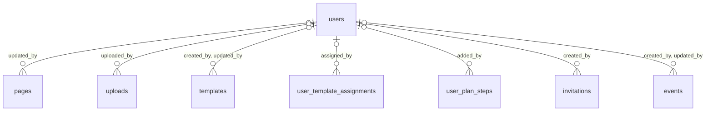

# ER-Diagramm

Datenmodell des Onboarding Portals (Stand v1). Quelle ist der Code, nicht der Entwurf:
`src/server/db/schema/*.ts`. Daraus ist die einzige Migration `drizzle/0000_initial.sql` generiert.
Datenbank: PostgreSQL 18, Zugriff über Drizzle ORM.

Allgemeine Konventionen:

- Primärschlüssel sind UUIDs (`gen_random_uuid()`). Ausnahmen: `page_completions` (zusammengesetzter
  Schlüssel `user_id` + `page_id`) und `page_edit_locks` (`page_id` ist zugleich Schlüssel).
- Alle Zeitstempel sind `timestamptz`. Gespeichert wird in UTC, angezeigt in Europe/Berlin.
- Zweisprachige Inhalte liegen in Spaltenpaaren `*_de` (Pflicht) und `*_en` (optional). Eine
  CHECK-Bedingung erzwingt, dass die englische Variante ganz oder gar nicht befüllt ist.
- Aufzählungen sind PostgreSQL-Enums (siehe Tabelle am Ende).

## 1. Fachliches Datenmodell

Das Diagramm zeigt alle Tabellen mit ihren wichtigsten Spalten und die fachlichen Beziehungen. Die reinen
Autor-Verweise (`created_by`, `updated_by` usw.) stehen zur besseren Lesbarkeit in Abschnitt 2.

```mermaid
erDiagram
    departments {
        uuid id PK
        text name UK
    }
    teams {
        uuid id PK
        uuid department_id FK
        text name "eindeutig je Abteilung"
    }
    job_roles {
        uuid id PK
        text name UK
    }
    users {
        uuid id PK
        text email UK
        text first_name
        text last_name
        user_role role "admin, team_lead, employee"
        uuid team_id FK
        uuid job_role_id FK
        uuid lead_id FK "Teamleiter, nie die Person selbst"
        date start_date
        locale locale "de, en"
        theme theme "light, dark, system"
        onboarding_status onboarding_status "active, completed, archived"
        timestamptz onboarding_completed_at
        boolean banned "Anmeldesperre bei Deaktivierung"
        timestamptz archived_at
    }
    sessions {
        uuid id PK
        uuid user_id FK
        text token UK
        timestamptz expires_at
        text ip_address
        text user_agent
    }
    accounts {
        uuid id PK
        uuid user_id FK
        text provider_id "credential"
        text password "Passwort-Hash"
    }
    verifications {
        uuid id PK
        text identifier "Passwort-Reset-Token"
        timestamptz expires_at
    }
    invitations {
        uuid id PK
        uuid user_id FK
        text token_hash UK "SHA-256, nie Klartext"
        timestamptz expires_at "72 Stunden"
        timestamptz accepted_at
        timestamptz revoked_at
    }
    modules {
        uuid id PK
        text title_de
        text title_en
        int sort_order
    }
    pages {
        uuid id PK
        uuid module_id FK
        page_status status "draft, published, archived"
        text title_de
        text title_en
        jsonb content_de "Tiptap-JSON"
        jsonb content_en
        text text_de "Klartext fuer die Suche"
        text text_en
        tsvector search_de "GENERATED, GIN-Index"
        tsvector search_en "GENERATED, GIN-Index"
        int sort_order
        timestamptz content_updated_at "zuletzt bearbeitet"
    }
    uploads {
        uuid id PK
        uuid page_id FK
        text storage_key UK
        text mime_type
        int size_bytes
    }
    page_edit_locks {
        uuid page_id PK, FK
        uuid user_id FK
        timestamptz acquired_at
        timestamptz expires_at "Lease, now() + 2 min"
    }
    templates {
        uuid id PK
        text name
        uuid department_id FK "NULL = unternehmensweit"
        uuid team_id FK "optional"
        uuid job_role_id FK "optional"
        template_status status "active, archived"
    }
    template_steps {
        uuid id PK
        uuid template_id FK
        uuid page_id FK
        phase phase
        int sort_order
    }
    user_template_assignments {
        uuid id PK
        uuid user_id FK
        uuid template_id FK
        timestamptz assigned_at
    }
    user_plan_steps {
        uuid id PK
        uuid user_id FK
        uuid page_id FK
        phase phase
        int sort_order
        uuid source_template_id FK "Herkunft, optional"
    }
    page_completions {
        uuid user_id PK, FK
        uuid page_id PK, FK
        timestamptz completed_at "einzige Fortschrittsangabe"
    }
    events {
        uuid id PK
        text title_de
        text title_en
        text description_de
        text description_en
        timestamptz starts_at
        timestamptz ends_at
        text location
        timestamptz last_announced_at
    }
    notifications {
        uuid id PK
        uuid user_id FK "Empfaenger"
        notification_type type
        text message_key "i18n-Schluessel"
        jsonb params
        text link
        uuid page_id FK
        uuid event_id FK
        uuid subject_user_id FK "betroffene Person"
        text dedupe_key
        timestamptz read_at
        timestamptz occurred_at
    }

    departments ||--o{ teams : "hat"
    teams |o--o{ users : "ordnet zu"
    job_roles |o--o{ users : "ordnet zu"
    users |o--o{ users : "leitet (lead_id)"
    users ||--o{ sessions : "hat"
    users ||--o{ accounts : "hat"
    users ||--o{ invitations : "erhaelt"
    modules ||--o{ pages : "enthaelt"
    pages ||--o{ uploads : "hat Bilder"
    pages ||--o| page_edit_locks : "ist gesperrt durch"
    users ||--o{ page_edit_locks : "haelt"
    departments |o--o{ templates : "Geltungsbereich"
    teams |o--o{ templates : "Geltungsbereich"
    job_roles |o--o{ templates : "Geltungsbereich"
    templates ||--o{ template_steps : "besteht aus"
    pages ||--o{ template_steps : "wird referenziert"
    users ||--o{ user_template_assignments : "bekommt zugewiesen"
    templates ||--o{ user_template_assignments : "wird zugewiesen"
    users ||--o{ user_plan_steps : "hat Plan"
    pages ||--o{ user_plan_steps : "wird referenziert"
    templates |o--o{ user_plan_steps : "Quelle"
    users ||--o{ page_completions : "schliesst ab"
    pages ||--o{ page_completions : "wird abgeschlossen"
    users ||--o{ notifications : "empfaengt"
    users |o--o{ notifications : "ist Gegenstand"
    pages |o--o{ notifications : "verweist"
    events |o--o{ notifications : "verweist"
```

## 2. Autor- und Herkunftsverweise

Diese Spalten halten fest, wer etwas angelegt oder geändert hat. Sie sind optional und werden beim
endgültigen Löschen der Person auf `NULL` gesetzt (`ON DELETE SET NULL`). Ein vollständiges Audit-Log
gibt es in v1 nicht.

## 3. Tabellenbeschreibungen

### Organisation

| Tabelle       | Zweck                                                                                                      |
| ------------- | ---------------------------------------------------------------------------------------------------------- |
| `departments` | Abteilungen (oberste Organisationsebene). Name eindeutig.                                                  |
| `teams`       | Teams innerhalb einer Abteilung. Name eindeutig je Abteilung. Die Abteilung einer Person ergibt sich über ihr Team. |
| `job_roles`   | Stellenrollen (z. B. „Frontend Developer“), unabhängig von der Abteilung. Name eindeutig.                 |

### Benutzer und Anmeldung

| Tabelle         | Zweck                                                                                                                                                                                                     |
| --------------- | --------------------------------------------------------------------------------------------------------------------------------------------------------------------------------------------------------- |
| `users`         | Personen mit genau einer Anwendungsrolle (`admin`, `team_lead`, `employee`), Team, Stellenrolle, Teamleitung (`lead_id`, Selbstbezug, CHECK `lead_id <> id`), Startdatum, Sprache, Theme und Onboarding-Status. E-Mail eindeutig. |
| `sessions`      | Sitzungen von Better Auth (Token, Ablauf, IP-Adresse, User-Agent). Werden beim Löschen der Person kaskadierend entfernt.                                                                                |
| `accounts`      | Anmeldekonten von Better Auth. In v1 nur der Anbieter `credential` mit dem Passwort-Hash. Fehlt das Passwort, ist die Einladung noch nicht angenommen.                                                    |
| `verifications` | Kurzlebige Tokens von Better Auth, in v1 nur für „Passwort vergessen“ (1 Stunde gültig).                                                                                                                 |
| `invitations`   | Einladungslinks („Passwort festlegen“). Gespeichert wird nur der SHA-256-Hash des Tokens. Eine neue Einladung widerruft offene ältere (`revoked_at`).                                                     |

### Inhalte

| Tabelle           | Zweck                                                                                                                                                                                                               |
| ----------------- | ------------------------------------------------------------------------------------------------------------------------------------------------------------------------------------------------------------------- |
| `modules`         | Kategorien der Seitenbibliothek, sortierbar. Ein Modul lässt sich nur löschen, solange es keine Seiten enthält (`ON DELETE RESTRICT`).                                                                             |
| `pages`           | Inhaltsseiten mit Status (`draft`, `published`, `archived`), zweisprachigem Tiptap-JSON, daraus extrahiertem Klartext und generierten Volltext-Vektoren (`german` bzw. `english`, gewichtet: Titel A, Text B). `content_updated_at` + `updated_by` bilden „zuletzt bearbeitet von / am“. |
| `uploads`         | Bilder einer Seite. Die Datei liegt im Speicher-Adapter unter `storage_key`, die Zeile hält Metadaten. Wird mit der Seite gelöscht (`CASCADE`).                                                                     |
| `page_edit_locks` | Bearbeitungssperre als Lease: höchstens eine Zeile je Seite (Primärschlüssel `page_id`). Abgelaufene Zeilen gelten als frei.                                                                                       |

### Vorlagen, Pläne und Fortschritt

| Tabelle                     | Zweck                                                                                                                                                                                                  |
| --------------------------- | ------------------------------------------------------------------------------------------------------------------------------------------------------------------------------------------------------ |
| `templates`                 | Onboarding-Vorlagen mit Geltungsbereich: Abteilung (`NULL` = unternehmensweit), optional Team und Stellenrolle. CHECK: ein Team setzt eine Abteilung voraus. Status `active` / `archived`.              |
| `template_steps`            | Geordnete Schritte einer Vorlage, je Schritt ein Verweis auf eine Seite und eine Phase. Eine Seite höchstens einmal je Vorlage.                                                                         |
| `user_template_assignments` | Welche Vorlagen einer Person zugewiesen wurden (Nachweis, eine Zeile je Person und Vorlage).                                                                                                           |
| `user_plan_steps`           | Persönlicher Plan: bei der Zuweisung kopierte Schritte (Snapshot) plus individuell ergänzte Seiten. Eine Seite höchstens einmal je Plan. `source_template_id` hält die Herkunft fest.                  |
| `page_completions`          | Abschluss einer Seite durch eine Person: nur „erledigt“ und Zeitpunkt. Bleibt erhalten, wenn der Schritt aus dem Plan entfernt wird, und zählt wieder, sobald er zurückkommt.                         |

### Veranstaltungen und Benachrichtigungen

| Tabelle         | Zweck                                                                                                                                                                                                                                                         |
| --------------- | ------------------------------------------------------------------------------------------------------------------------------------------------------------------------------------------------------------------------------------------------------------- |
| `events`        | Veranstaltungen mit zweisprachigem Titel und Beschreibung, Beginn, Ende (CHECK `ends_at >= starts_at`) und Ort. `last_announced_at` hält die letzte Ankündigung fest.                                                                                         |
| `notifications` | Anwendungsinterne Benachrichtigungen. Text als i18n-Schlüssel + Parameter, damit jede Person sie in ihrer Sprache sieht. Ein partieller Unique-Index auf (`user_id`, `dedupe_key`) für ungelesene Zeilen verhindert Duplikate. Benachrichtigungen über eine gelöschte Person werden mitgelöscht (`subject_user_id` mit `CASCADE`). |

## 4. Löschverhalten der Fremdschlüssel

| Verhalten  | Beziehungen                                                                                                                                                                                                      |
| ---------- | ---------------------------------------------------------------------------------------------------------------------------------------------------------------------------------------------------------------- |
| `CASCADE`  | Alles, was einer Person gehört: `sessions`, `accounts`, `invitations`, `user_plan_steps`, `user_template_assignments`, `page_completions`, `page_edit_locks`, eigene und sie betreffende `notifications`. Ferner `uploads` und `page_edit_locks` einer Seite sowie `template_steps` einer Vorlage. |
| `RESTRICT` | Stammdaten, die noch verwendet werden: Abteilung → Teams/Vorlagen, Team/Stellenrolle → Personen/Vorlagen, Modul → Seiten, Seite → Vorlagenschritte/Planschritte/Abschlüsse, Vorlage → Zuweisungen, Teamleitung → geführte Personen. |
| `SET NULL` | Autor-Verweise (Abschnitt 2), `user_plan_steps.source_template_id`, `notifications.page_id` und `notifications.event_id` (eine Ankündigung zu einer gelöschten Veranstaltung erscheint als „Veranstaltung entfernt“). |

Die Dienste prüfen die Verwendung zusätzlich vor dem Löschen und archivieren verwendete Seiten und
Vorlagen, statt sie zu löschen. Das `RESTRICT` der Datenbank fängt nebenläufige Fälle ab.

## 5. Aufzählungen (Enums)

| Enum                | Werte                                                                                  |
| ------------------- | -------------------------------------------------------------------------------------- |
| `user_role`         | `admin`, `team_lead`, `employee`                                                       |
| `onboarding_status` | `active`, `completed`, `archived`                                                      |
| `page_status`       | `draft`, `published`, `archived`                                                       |
| `template_status`   | `active`, `archived`                                                                   |
| `phase`             | `before_start`, `first_day`, `first_week`, `first_month` (Vor dem Start, Erster Tag, Erste Woche, Erster Monat) |
| `notification_type` | `step_added`, `page_updated`, `event_announced`, `employee_assigned`, `onboarding_completed` |
| `locale`            | `de`, `en`                                                                             |
| `theme`             | `light`, `dark`, `system`                                                              |
