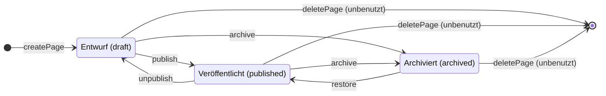
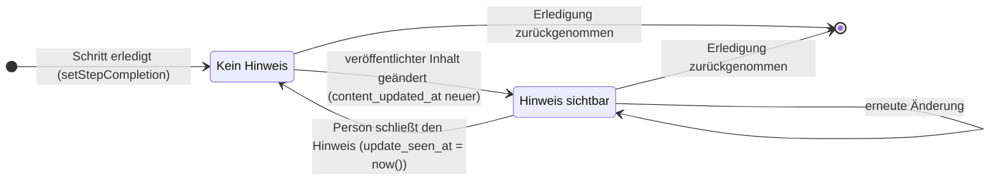
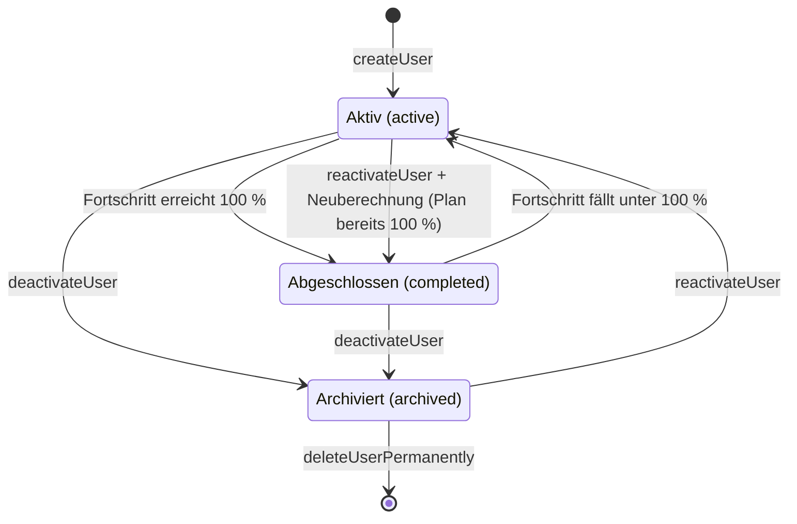
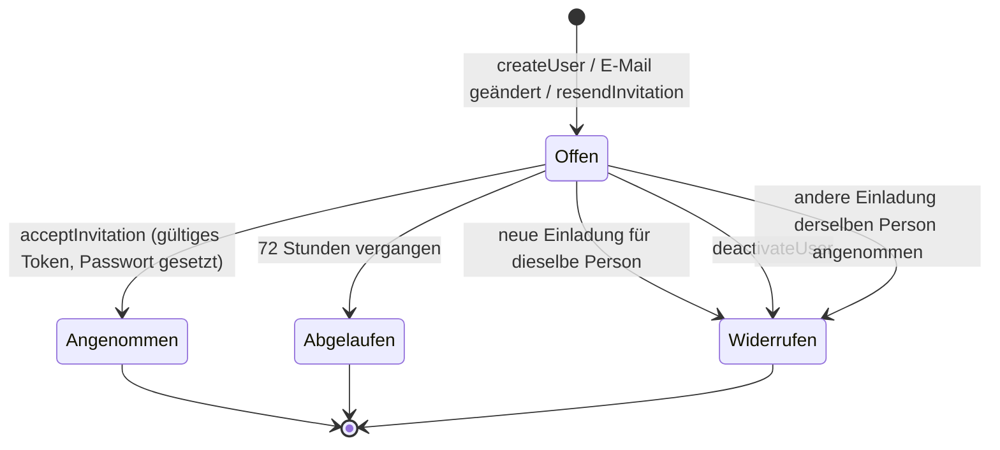
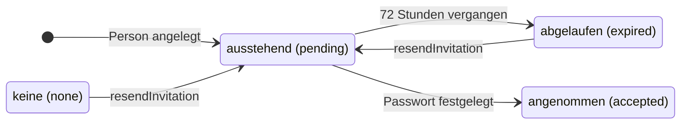
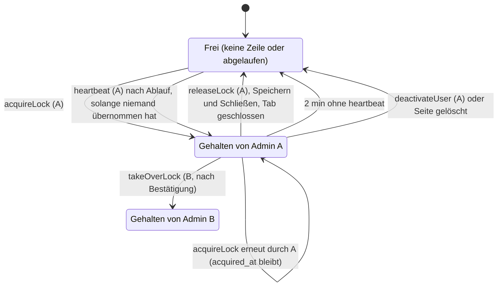
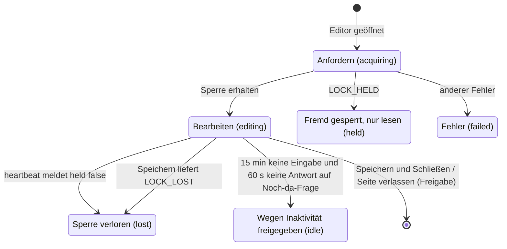
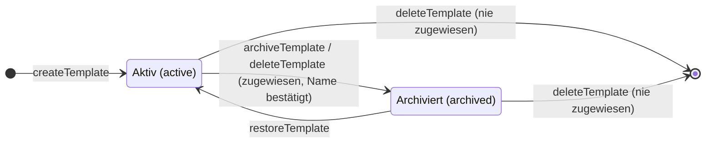
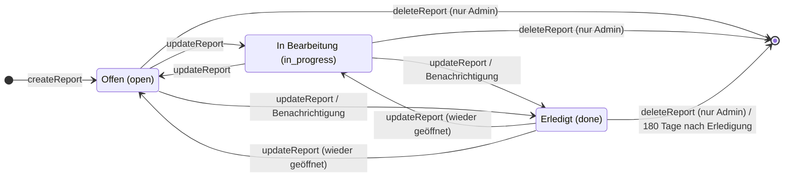

# Zustandsdiagramme

Zustände und Übergänge, wie sie im Code umgesetzt sind. Die Zustandsautomaten für Seite und Onboarding
sind als reine Funktionen ohne Datenbankzugriff implementiert und separat unit-getestet:

- Seite: `src/lib/domain/page-status.ts` (`PAGE_TRANSITIONS`, `nextPageStatus`)
- Onboarding: `src/lib/domain/onboarding-status.ts` (`applyOnboardingEvent`)
- Einladung: `src/server/services/invitations.ts`
- Bearbeitungssperre: `src/server/services/locks.ts` (Server) und `src/components/editor/use-edit-lock.ts` (Editor)
- Meldung („Problem melden“, seit v1.1): `src/server/services/feedback.ts` (`updateReport`)

Ein nicht erlaubter Übergang wird mit dem Fehlercode `INVALID_TRANSITION` abgelehnt.

## 1. Status einer Inhaltsseite

| Übergang                   | Auslöser                                                                                         | Nebenwirkungen                                                                                                                                                            |
| -------------------------- | ------------------------------------------------------------------------------------------------ | ------------------------------------------------------------------------------------------------------------------------------------------------------------------------- |
| neu → Entwurf              | Admin oder Teamleitung (nur in Modulen der eigenen Abteilung) legt Seite an (`createPage`)       | leerer Inhalt, ans Ende des Moduls sortiert                                                                                                                               |
| Entwurf → Veröffentlicht   | `changePageStatus(publish)`                                                                      | Fortschritt aller nicht archivierten Planinhaber wird neu berechnet; sie erhalten „Seite aktualisiert“ (außer der handelnden Person)                                       |
| Veröffentlicht → Entwurf   | `changePageStatus(unpublish)`                                                                    | Schritt zählt nicht mehr; Neuberechnung (kann ein Onboarding auf „abgeschlossen“ setzen)                                                                                   |
| → Archiviert               | `changePageStatus(archive)` oder `deletePage` einer **verwendeten** Seite (Bestätigung durch Eingabe des Titels) | wie oben; Abschlüsse bleiben gespeichert                                                                                                                       |
| Archiviert → Veröffentlicht | `changePageStatus(restore)`                                                                     | Neuberechnung (kann ein abgeschlossenes Onboarding wieder öffnen); keine „Seite aktualisiert“-Meldung                                                                     |
| → gelöscht                 | `deletePage` einer **unbenutzten** Seite (nur Admin; Teamleitungen archivieren stattdessen)      | Zeile und Bilddateien werden entfernt. „Verwendet“ = in einem Vorlagenschritt, in irgendeinem Plan (auch archivierter Personen) oder mit Abschlussvermerk. Eine verwendete archivierte Seite kann nicht gelöscht werden (`IN_USE`). |

Alle Übergänge dürfen der Admin und – seit v1.1 – die Teamleitungen der Abteilung, der das Modul der
Seite gehört. Teamleitungen veröffentlichen direkt, ohne Freigabe durch den Admin.

Kein Statuswechsel, aber relevant: Speichert ein Admin oder eine zuständige Teamleitung den Inhalt einer
**veröffentlichten** Seite, gehen die Änderungen sofort live und alle aktiven und abgeschlossenen
Planinhaber außer dem Bearbeiter erhalten „Seite aktualisiert“ (eine ungelesene Meldung je Seite wird
aufgefrischt statt verdoppelt). Bereits erteilte Abschlüsse bleiben erhalten; der Plan zeigt den Hinweis
„Seit deinem Abschluss aktualisiert“ (Abschnitt 1.1).

Sichtbarkeit je Status: Employees sehen nur `published`; Teamleiter `published` und zusätzlich `draft`
und `archived` der Module ihrer Abteilung; Admins alle Status (siehe Berechtigungskonzept, Abschnitt 5.1).

### 1.1 Hinweis „Seit deinem Abschluss aktualisiert“

Seit v1.1 kann die Person den Hinweis mit einem Klick schließen. Gespeichert wird nur der Zeitpunkt in
`page_completions.update_seen_at`; Abschlussdatum und Fortschritt ändern sich nicht.

Der Hinweis ist sichtbar, solange `content_updated_at` der Seite jünger ist als der spätere der beiden
Zeitpunkte `completed_at` und `update_seen_at`. Schließt die Person ihn, verschwindet er auch in der
Planansicht von Teamleitung und Admin. Wird die Seite danach erneut geändert, erscheint er wieder.

## 2. Onboarding-Status einer Person

Der Fortschritt ist `abgeschlossene aktive Schritte / aktive Schritte`. Aktiv ist ein Schritt, dessen Seite
veröffentlicht ist. Ein leerer Plan (0 aktive Schritte) bleibt `active`.

| Übergang                  | Auslöser                                                                                                                                                                                                                                                         | Nebenwirkungen                                                                                                                                                       |
| ------------------------- | ---------------------------------------------------------------------------------------------------------------------------------------------------------------------------------------------------------------------------------------------------------------- | -------------------------------------------------------------------------------------------------------------------------------------------------------------------- |
| aktiv → abgeschlossen     | Neuberechnung ergibt 100 %. Ausgelöst durch: Schritt erledigt (`setStepCompletion`), Schritt entfernt (`removePlanStep`), letzte offene Seite wird zurückgezogen oder archiviert (`onPageStatusChanged`)                                                         | `onboarding_completed_at` wird gesetzt; Teamleitung (falls nicht archiviert) und alle aktiven Admins erhalten „Onboarding abgeschlossen“, nie die Person selbst       |
| abgeschlossen → aktiv     | Neuberechnung ergibt unter 100 %. Ausgelöst durch: Erledigung zurückgenommen, Seite ergänzt (`addPlanStep`), Vorlage zugewiesen (`assignTemplates`), Seite veröffentlicht oder wiederhergestellt                                                               | `onboarding_completed_at` wird geleert. Erneutes Abschließen meldet erneut (bei ungelesener Meldung wird diese aufgefrischt)                                          |
| aktiv / abgeschlossen → archiviert | Admin deaktiviert (`deactivateUser`)                                                                                                                                                                                                                    | `banned = true`, `archived_at` gesetzt, alle Sitzungen gelöscht, offene Einladungen widerrufen, Bearbeitungssperren freigegeben. Fortschrittsänderungen werden ignoriert |
| archiviert → aktiv        | Admin reaktiviert (`reactivateUser`)                                                                                                                                                                                                                             | Sperre aufgehoben; anschließend stille Neuberechnung: ist der Plan zu 100 % erledigt, direkt `completed`, ohne Benachrichtigung                                       |
| archiviert → gelöscht     | Admin löscht endgültig (`deleteUserPermanently`), Bestätigung durch Eingabe des vollständigen Namens                                                                                                                                                              | nur wenn die Person niemanden mehr leitet; löscht per Kaskade Sitzungen, Konten, Einladungen, Plan, Abschlüsse, eigene Benachrichtigungen und Benachrichtigungen über die Person |

Abgelehnt werden: Deaktivieren einer bereits archivierten Person, Reaktivieren einer nicht archivierten
Person, endgültiges Löschen einer nicht archivierten Person (jeweils `INVALID_TRANSITION`), Deaktivieren
des letzten aktiven Admins (`LAST_ADMIN`) und der eigenen Person (`FORBIDDEN`).

Alle Änderungen an Plan, Abschlüssen und Status laufen in einer Transaktion unter einer Zeilensperre
der Person (`lockUserInTx`). Zwei gleichzeitige Erledigungen der letzten beiden offenen Schritte führen
daher zuverlässig zu `completed`.

## 3. Einladung („Passwort festlegen“)

### 3.1 Einzelne Einladung (Zeile in `invitations`)

| Übergang                 | Auslöser                                                                                                                                  | Nebenwirkungen                                                                                                                                                                     |
| ------------------------ | ----------------------------------------------------------------------------------------------------------------------------------------- | ---------------------------------------------------------------------------------------------------------------------------------------------------------------------------------- |
| neu → offen              | Admin legt Person an; Admin ändert die E-Mail vor der Annahme; Admin sendet die Einladung erneut (nur aktive Personen ohne Passwort)    | Zufallstoken (32 Byte); gespeichert wird nur der SHA-256-Hash. Alle bisher offenen Einladungen der Person werden widerrufen. Mail in der Sprache der Person (nach dem Commit)       |
| offen → angenommen       | Person öffnet den Link und setzt ein Passwort (min. 12 Zeichen)                                                                           | in einer Transaktion unter Zeilensperre: Passwort-Konto angelegt, E-Mail als bestätigt markiert, übrige offene Einladungen widerrufen, **alle Sitzungen der Person beendet**         |
| offen → abgelaufen       | Zeitablauf (`expires_at`), kein Job nötig                                                                                                 | Link liefert „abgelaufen“ (`INVITE_EXPIRED`); Abhilfe nur durch „Einladung erneut senden“                                                                                          |
| offen → widerrufen       | neue Einladung, Deaktivierung der Person, Annahme einer anderen Einladung                                                                | Link liefert „ungültig“ (`INVITE_INVALID`)                                                                                                                                         |

Ein Token gilt außerdem als ungültig, wenn die Person gesperrt oder archiviert ist. Ein bereits benutztes
Token ergibt „bereits verwendet“.

### 3.2 Einladungsstatus in der Benutzerverwaltung

Die Detailseite eines Benutzers zeigt einen abgeleiteten Status (`getInvitationState`):

- `accepted`, sobald ein Passwort-Konto existiert, unabhängig von den Einladungszeilen.
- Sonst entscheidet die jüngste Einladung: offen und nicht abgelaufen → `pending`, sonst `expired`
  (auch widerrufen). Ohne Einladung → `none`.

## 4. Bearbeitungssperre (Lease) einer Seite

Die Sperre ist eine Zeile in `page_edit_locks` mit `expires_at = now() + 120 s`. Es wird keine
Datenbankverbindung offen gehalten, und es gibt keinen Aufräumjob: eine abgelaufene Zeile gilt als frei.
Alle Zeitvergleiche nutzen die Uhr der Datenbank (`now()`).

Seit v1.1 können neben Admins auch die Teamleitungen der Abteilung, der das Modul gehört, die Sperre
holen, übernehmen und speichern. „Admin A“ und „Admin B“ in den Diagrammen stehen daher für jede
berechtigte bearbeitende Person; eine Teamleitung und ein Admin können sich gegenseitig ablösen.

### 4.1 Serverseitige Zustände

| Aktion                    | Verhalten                                                                                                                                                                                                                       |
| ------------------------- | ------------------------------------------------------------------------------------------------------------------------------------------------------------------------------------------------------------------------------- |
| Holen (`acquireLock`)     | Ein einziges atomares `INSERT … ON CONFLICT DO UPDATE … WHERE expires_at < now() OR user_id = ich`. Ist die Sperre fremd und gültig: `LOCK_HELD` mit Name und Beginn des Inhabers. Von zwei gleichzeitigen Admins gewinnt genau einer. |
| Verlängern (`heartbeat`)  | `POST /api/locks/{pageId}/heartbeat` alle 30 s. Verlängert die eigene Sperre, auch wenn sie inzwischen abgelaufen ist, solange niemand übernommen hat. Hält ein anderer die Sperre: `held: false` mit dessen Namen.          |
| Freigeben (`releaseLock`) | Löscht nur die eigene Zeile. Beim Verlassen der Seite per `sendBeacon` an `POST /api/locks/{pageId}/release`. Kommt die Anfrage nicht an, läuft die Sperre nach 2 Minuten ab.                                                  |
| Übernehmen (`takeOverLock`) | Schreibt die Sperre bedingungslos auf den übernehmenden Admin und setzt `acquired_at` neu. Die Oberfläche fragt vorher nach.                                                                                                |
| Speichern                 | `savePageContent` prüft in derselben Transaktion mit `SELECT … FOR UPDATE`, dass die Sperre dem Speichernden gehört und gültig ist; sonst `LOCK_LOST`. Beim Speichern wird eine verlorene Sperre nie neu geholt.                |

### 4.2 Zustände im Editor (Client)

- Andere Bearbeitende (Admin oder Teamleitung) sehen die Seite schreibgeschützt mit dem Hinweis, wer seit
  wann bearbeitet; der Name wird unabhängig von der Rolle der haltenden Person angezeigt.
- Bei `lost` und `idle` wird der ungespeicherte Stand als Entwurf im `localStorage` des Browsers
  abgelegt. Beim nächsten Öffnen mit erhaltener Sperre bietet der Editor die Wiederherstellung an.
- Kurzzeitige Server- oder Netzfehler beim Heartbeat führen nicht zum Verlust; der nächste Takt versucht es erneut.

## 5. Ergänzend: Status einer Vorlage

Archivierte Vorlagen werden bei der Zuweisung nicht mehr angeboten. Bestehende Pläne bleiben unverändert,
weil die Schritte bei der Zuweisung kopiert wurden (Snapshot). Seit v1.1 dürfen Teamleitungen die
Übergänge für Vorlagen ihrer Abteilung auslösen, die von einer Teamleitung angelegt wurden
(`lead_managed = true`); alle übrigen Vorlagen nur der Admin.

## 6. Status einer Meldung („Problem melden“, seit v1.1)

| Übergang                  | Auslöser                                                                                                                       | Nebenwirkungen                                                                                                                                                                                         |
| ------------------------- | ------------------------------------------------------------------------------------------------------------------------------ | ------------------------------------------------------------------------------------------------------------------------------------------------------------------------------------------------------ |
| neu → offen               | jede angemeldete Person meldet ein Problem (`createReport`)                                                                    | höchstens 5 Meldungen je Person in einer rollierenden Stunde (`RATE_LIMITED`); Seite nur verknüpft, wenn für die meldende Person sichtbar. Der Zähler offener Meldungen in der Navigation steigt       |
| offen ↔ in Bearbeitung    | Admin bzw. zuständige Teamleitung ändert den Status (`updateReport`), optional mit Antwortnotiz                               | `handled_by` = bearbeitende Person                                                                                                                                                                     |
| → erledigt                | `updateReport` mit Status `done`                                                                                               | `resolved_at` wird gesetzt; die meldende Person erhält in derselben Transaktion die Benachrichtigung `feedback_resolved` (Betreff, ggf. Antwortnotiz, Link auf den gemeldeten Pfad), sofern sie noch existiert und nicht archiviert ist. Schlägt das Anlegen der Benachrichtigung fehl, wird auch der Statuswechsel zurückgerollt |
| erledigt → erledigt       | erneutes Speichern, z. B. geänderte Antwortnotiz                                                                               | `resolved_at` bleibt; **keine** zweite Benachrichtigung                                                                                                                                                |
| erledigt → offen / in Bearbeitung | Meldung wird wieder geöffnet                                                                                          | `resolved_at` wird geleert. Ein späteres erneutes Erledigen benachrichtigt erneut (eine noch ungelesene Meldung wird aufgefrischt statt verdoppelt)                                                    |
| → gelöscht                | Admin löscht (`deleteReport`) oder Aufbewahrungsfrist: erledigte Meldungen werden 180 Tage nach `resolved_at` beim Öffnen der Meldungsliste entfernt (kein Cronjob) | –                                                                                                                                                                                                      |

Alle Status sind in jede Richtung erreichbar; es gibt daher keinen `INVALID_TRANSITION`. Eine Meldung
außerhalb des eigenen Bereichs ergibt `NOT_FOUND` (Berechtigungskonzept, Abschnitt 5.5).
